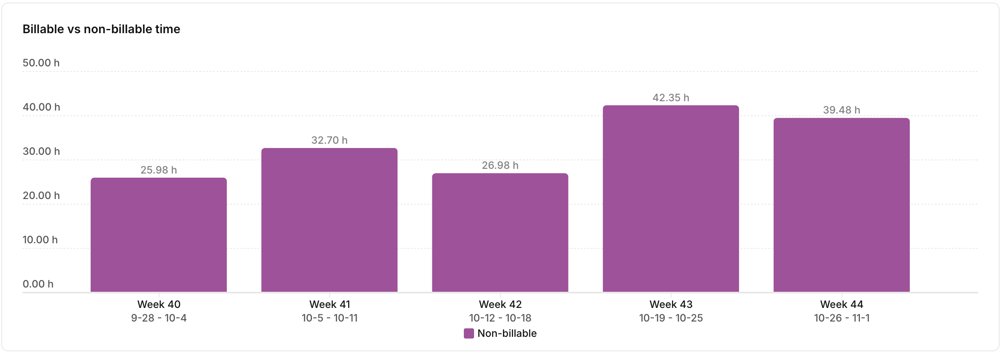

 

10월, 2026년 하반기 입사 지원에 몰입했던 한달이 지났네요.. 
9월 한달동안 blaybus라는 커리어 성장기록 서비스를 써오면서 작업 시간을 기록하면서 회고하고, 새로운 목표를 다져왔지만
10월부터는 클로드와 MCP로 연결해서 더 적극적으로 제 생활 루틴을 관찰하기 위해 Toggl을 써보기 시작했습니다. 
역시 새벽에 주로 작업하는 제 모습을 클로드가 지적해주더라고요(그치만 고치지 못해..ㅠㅠ)
이번 달 진행 상황은 담백하게 기록해보겠습니다.

 

### 10월에 주로 한 일

총 **167.5시간**, 하루 평균 5.4시간 (Toggl 기준)

| 분야               | 시간 | 비중 |
|------------------| --- | --- |
| SCENE (사이드 프로젝트) | 69.0h | 41% |
| 코딩 테스트 준비        | 29.1h | 17% |
| 하반기 입사 지원        | 26.3h | 15% |
| DPlanner 운영      | 18.9h | 11% |
| 포트폴리오 정리         | 15.9h | 9% |
| 정리·계획            | 7.6h | 4% |
| 기술 블로그           | 0.6h | 0% |

 

**SCENE** (대학 스트릿댄스 씬 커뮤니티, PO)
- 스프린트 1(발견), 2(기획) 진행
- 스토리 맵·MVP 1 범위 잡기
- 기술 결정 1차: ADR 5개 승인 (Spring Boot 4.1·PostgreSQL·AWS·Expo)

**코딩 테스트**
- 풀이 루틴에 익숙해지는 중 (시간복잡도 → 자료구조 → 예상 풀이 → 코딩 → 테스트)
- 오답 노트 시작 → 자주 틀리는 유형: 자료구조 선택, 인덱스 경계, 엣지 케이스

**입사 지원**
- 서류 합격 후 온라인 코딩 테스트 2회 응시
- 서류 통과율이 낮아 포트폴리오를 다시 다듬는 중

**DPlanner 운영**
- App스토어: 개발자 멤버십이 끊겨 잠깐 내려감 → 갱신 후 1.3.2 업데이트 배포
- Play스토어: 예전 계정 해지로 내려간 앱을 새 계정으로 다시 출시하는 중 (프로덕션 신청 거절 → 테스터 다시 모집)
- 운영 계정이 개인 명의에 묶이면 서비스가 멈출 수 있다는 걸 겪음 → iOS 앱 본인 계정 이전 계획 세움

**포트폴리오**
- 포트폴리오 진행이 제일 더디다고 판단함
- 11월 포트폴리오 계획 세움 (MINE → DPlanner → C.Groove → OneGate)

**기록 방식**
- 작업 시간 기록을 Toggl로 옮김 (10/21~)

 

---

### 10월 회고 (KPT)

| 구분 | 내용                                                                                |
| --- |-----------------------------------------------------------------------------------|
| **Keep** | 클로드 코드로 일정 및 작업을 관리할 수 있는 체계를 만들어둠, Toggl로 생활 패턴 파악하기                             |
| **Problem** | 일정하지 못한 생활 루틴, 하루 편차 큼 (0.4h ~ 9.4h), 새벽 0~6시 시작 36.5h (약 22%)                    |
| **Try** | 우선 순위를 정확하게 파악하기(포트폴리오를 11/15까지 끝내도록), 회고는 월 1회로 가볍게 진행하기, 01시 이후 새 작업 안 하는 습관 들이기 |

 

---

### 11월에는

- TIL 써 보는 중 (11/3~). 순서보다 다양한 주제를 꾸준하게 공부하기
- 포트폴리오를 11/15까지 마무리하기!

 
